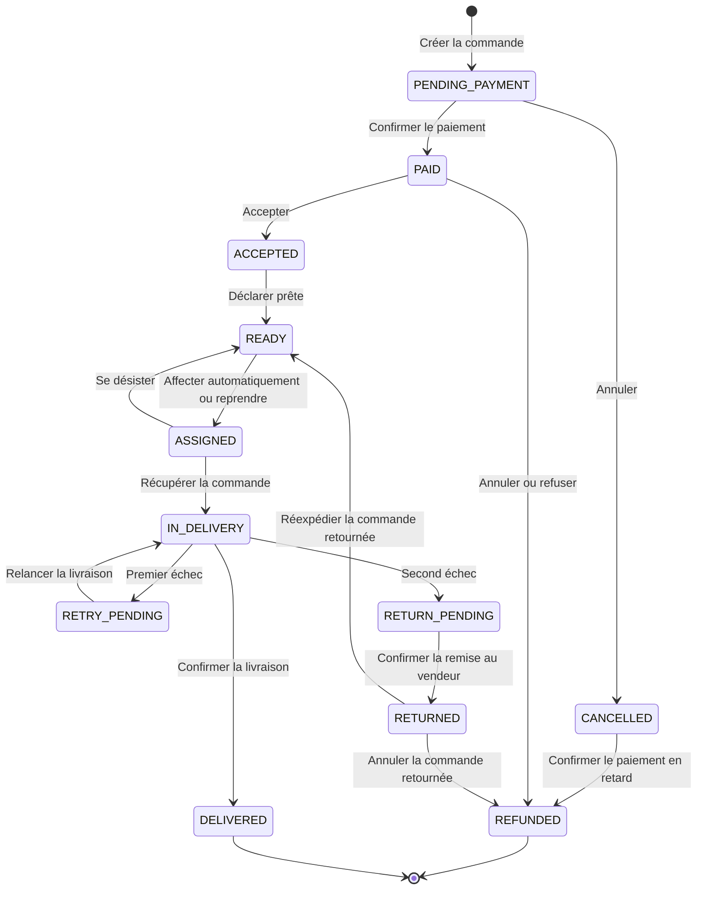

# Note de conception de la place de marché

Une commande relie un acheteur à un vendeur. Le système confirme le paiement mobile money et assigne un livreur une fois la commande prête. Chaque transition validée est enregistrée dans l’historique.

## États et transitions

| Action | État de départ | État d’arrivée | Rôle autorisé et condition |
| --- | --- | --- | --- |
| Créer la commande | — | `PENDING_PAYMENT` | Acheteur qui passe la commande |
| Confirmer le paiement | `PENDING_PAYMENT` | `PAID` | Système, à la réception de la notification de succès |
| Annuler avant confirmation du paiement | `PENDING_PAYMENT` | `CANCELLED` | Acheteur de la commande |
| Traiter une confirmation reçue après l’annulation | `CANCELLED` | `REFUNDED` | Système, à la réception d’une première notification de succès |
| Annuler après confirmation du paiement | `PAID` | `REFUNDED` | Acheteur de la commande |
| Refuser la commande | `PAID` | `REFUNDED` | Vendeur de la commande |
| Accepter la commande | `PAID` | `ACCEPTED` | Vendeur de la commande |
| Déclarer la commande prête | `ACCEPTED` | `READY` | Vendeur de la commande |
| Assigner un livreur | `READY` | `ASSIGNED` | Système, si un livreur éligible est choisi |
| Se désister | `ASSIGNED` | `READY` | Livreur assigné. L’affectation est effacée. |
| Récupérer la commande | `ASSIGNED` | `IN_DELIVERY` | Livreur assigné |
| Confirmer la livraison | `IN_DELIVERY` | `DELIVERED` | Livreur assigné |
| Signaler un premier échec | `IN_DELIVERY` | `RETRY_PENDING` | Livreur assigné. Le client est injoignable. |
| Relancer la livraison | `RETRY_PENDING` | `IN_DELIVERY` | Même livreur, pour l’unique nouvelle tentative de cet envoi |
| Signaler un second échec | `IN_DELIVERY` | `RETURN_PENDING` | Livreur assigné. Le client est toujours injoignable. |
| Confirmer la remise au vendeur | `RETURN_PENDING` | `RETURNED` | Livreur assigné |
| Réexpédier la commande retournée | `RETURNED` | `READY` | Vendeur de la commande. Réinitialise le compteur d’échecs et libère l’affectation. |
| Annuler la commande retournée | `RETURNED` | `REFUNDED` | Vendeur de la commande. Remboursement simulé. |

L’acheteur peut annuler depuis `PENDING_PAYMENT` ou `PAID`. Dès que le vendeur accepte la commande (`ACCEPTED`), l’annulation par l’acheteur est interdite.

Après la préparation, un désistement ou une réexpédition, le service enregistre la transition vers `READY`, puis tente une affectation automatique dans la même transaction. Il choisit par identifiant croissant parmi les livreurs éligibles. Il écarte ceux qui se sont désistés de cette commande et celui qui a effectué la dernière remise au vendeur. La réponse contient `ASSIGNED` et l’identifiant du livreur choisi, ou `READY` et un identifiant nul si aucun livreur n’est éligible.

`RETURNED` attend la décision du vendeur. `REFUNDED` et `DELIVERED` sont des états finaux. Chaque action vérifie le rôle de l’acteur. Pour une commande existante, l’identité d’un acheteur, d’un vendeur ou d’un livreur doit aussi correspondre à celle enregistrée sur la commande. Une action hors tableau est rejetée sans modification ni ajout à l’historique.

## Modèle de données

Les données sont stockées dans PostgreSQL. Les acheteurs (`BUYER`), les vendeurs (`SELLER`) et les livreurs (`COURIER`) partagent la table `actors`, car ils ont les mêmes champs dans cet exercice. Chaque identité de démonstration possède un rôle. Une identité technique `SYSTEM` permet aussi d’attribuer au système ses actions dans l’historique.

| Table | Données et contraintes |
| --- | --- |
| `actors` | `id` (primary key), `role` (`BUYER`, `SELLER`, `COURIER`, or `SYSTEM`) |
| `orders` | `id` (primary key), `buyer_id`, `seller_id`, `courier_id` (foreign keys to `actors`, with only `courier_id` nullable), `amount_xof` (positive integer), `status`, `failed_delivery_attempts` (0 to 2 for the current shipment, defaults to 0) |
| `payments` | `reference` (primary key), `order_id` (unique foreign key to `orders`), `received_at` (UTC) |
| `order_history` | `id` (primary key), `order_id` (foreign key to `orders`), `actor_id` (foreign key to `actors`), `actor_role` (role at the time of the action), `action`, `from_status` (null on creation), `to_status`, `occurred_at` (UTC), `reason` (optional), `assigned_courier_id` (foreign key to `actors`, required for assignment events and null otherwise) |

Le service lit le rôle depuis `actors` à partir de l’identifiant simulé. Il vérifie aussi le rôle du vendeur à la création et celui du livreur à l’affectation.

La création de la commande et chaque changement d’état validé ajoutent une entrée à `order_history` dans la même transaction que l’écriture de la commande. Chaque entrée indique l’identifiant et le rôle de l’acteur. L’acheteur est identifié lorsqu’il crée ou annule la commande, et le vendeur lorsqu’il l’accepte, la refuse, la déclare prête ou décide de la suite après retour. L’historique se lit par ordre croissant d’identifiant. Les actions `reship` et `cancel_returned` identifient la décision prise après la remise. Le motif `customer_unreachable` est enregistré à chaque échec de livraison.

Pour une affectation, l’entrée identifie le système dans `actor_id` et le livreur choisi dans `assigned_courier_id`. Une affectation automatique porte le motif `automatic_assignment`. En cas de désistement, le service trace la libération de la commande avant l’éventuelle nouvelle affectation. Les entrées d’affectation conservent le livreur et l’heure de chaque affectation successive.

## Idempotence des notifications de paiement

Pour toute action qui peut modifier une commande existante, le service ouvre une transaction `READ COMMITTED` et verrouille la ligne avec `SELECT ... FOR UPDATE` avant de vérifier l’état. Deux actions sur la même commande sont ainsi traitées l’une après l’autre. Si l’acceptation est validée en premier, l’annulation voit l’état `ACCEPTED` et est rejetée. [Documentation PostgreSQL sur les verrous de ligne](https://www.postgresql.org/docs/current/explicit-locking.html#LOCKING-ROWS)

Pour une notification de paiement, le système recherche la référence avant de vérifier si la transition est encore possible. Si elle est déjà associée à cette commande, il renvoie l’état courant avec succès sans écrire dans l’historique. Les contraintes d’unicité de `payments.reference` et de `payments.order_id` empêchent de réutiliser la même référence pour deux commandes ou d’enregistrer deux références pour une seule commande. Ces cas donnent lieu à un conflit, même en cas d’insertions simultanées.

Pour une nouvelle référence valide, l’enregistrement du paiement, la mise à jour de la commande et l’ajout à l’historique sont validés dans la même transaction. Si une étape échoue, toutes ces écritures sont annulées.

## Hypothèses métier

- Une commande a un seul paiement intégral. La notification simulée confirme le succès du paiement pour le montant attendu. La référence est unique sur la plateforme.
- Une annulation avant confirmation passe à `CANCELLED`. Si le paiement est confirmé plus tard, la commande passe directement à `REFUNDED`. Une annulation après paiement ou un refus du vendeur produit aussi un remboursement simulé en un changement d’état.
- La charge de travail des livreurs est hors périmètre de cet exercice. Le système peut indiquer explicitement un livreur éligible pour reprendre une commande en attente.
- Après la prise en charge, le même livreur peut faire une nouvelle tentative puis, si nécessaire, rapporte le colis au vendeur. Le retour s’achève quand le livreur confirme la remise.
- Pour la suite après retour, chaque réexpédition ouvre un nouvel envoi de la même commande avec deux essais au maximum. Le paiement initial et l’historique sont conservés. Si le vendeur annule après le retour, l’état `REFUNDED` représente le remboursement simulé et la référence initiale reste enregistrée pour l’audit et l’idempotence.

## Diagramme des états

